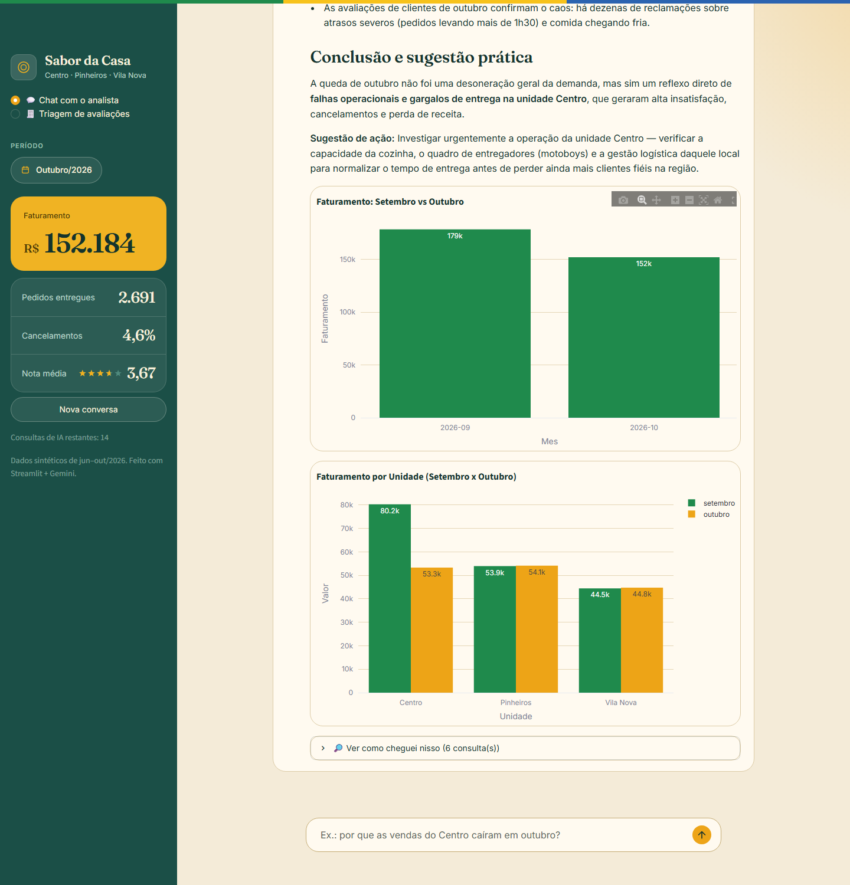
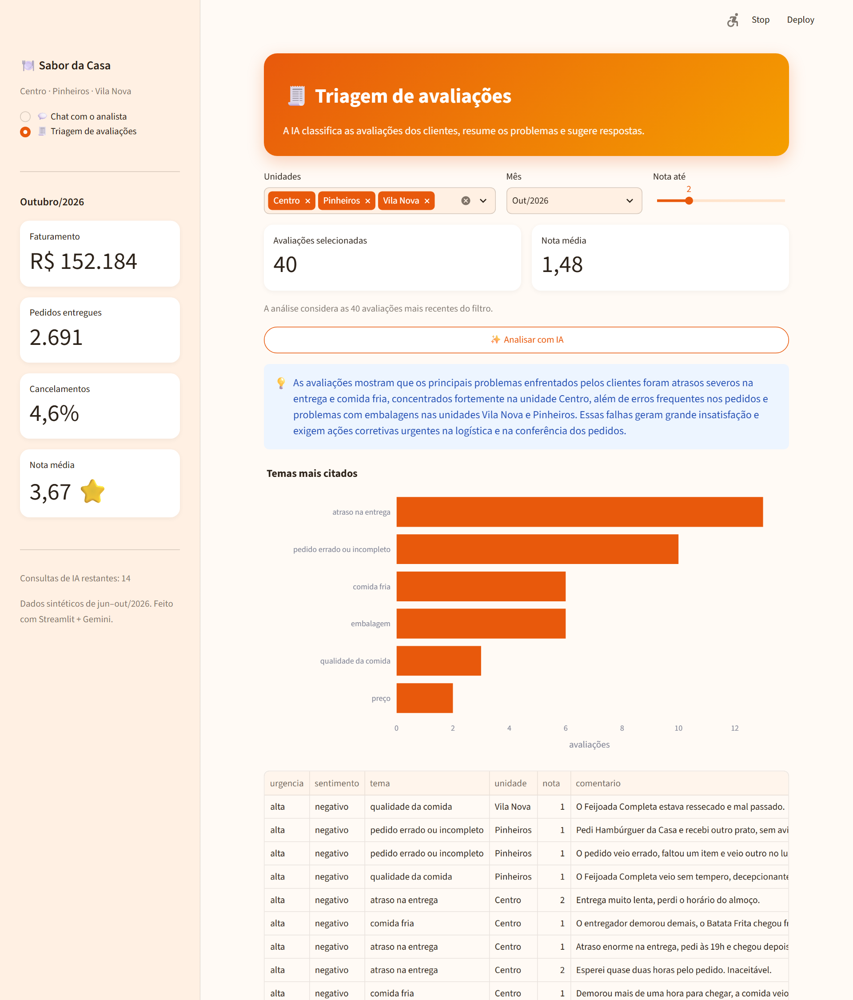
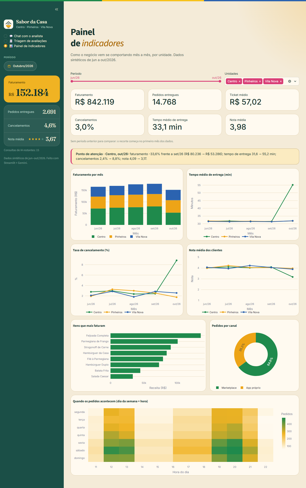
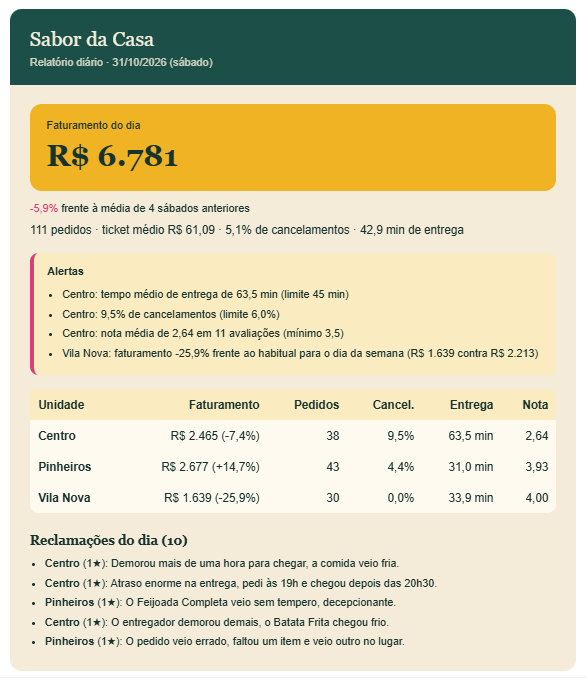

# Copiloto do Restaurante Parceiro

Agente de IA que ajuda o dono de um restaurante de delivery a entender vendas e avaliações **em linguagem natural**: ele recebe a pergunta em português, escreve as consultas SQL, lê os resultados e responde de forma direta, mostrando também como chegou nos números.

🚀 **[Experimente online](https://copiloto-restaurante.streamlit.app/)** (sem cadastro; a demo tem limite diário de consultas)

Todos os dados são **sintéticos** (jun–out/2026, 3 unidades), gerados por `dados/gerar_dados.py`. O projeto não usa dados reais nem marcas de terceiros.


## O que ele faz

- 💬 **Chat com agente de análise**: perguntas abertas como "por que o faturamento caiu em outubro?" fazem o agente investigar períodos, unidades, cancelamentos e avaliações antes de concluir.
- 📈 **Gráficos nas respostas**: o agente decide quando um gráfico ajuda e o desenha (Plotly) a partir de uma consulta SQL.
- 🧾 **Triagem de avaliações**: a IA classifica cada comentário (sentimento, tema, urgência), resume os problemas mais frequentes e escreve um rascunho de resposta para o cliente.
- 📊 **Painel de indicadores**: faturamento, ticket médio, cancelamentos, tempo de entrega e nota por unidade e por mês, com filtro de período, comparação com o período anterior e um alerta automático apontando a unidade com maior queda. Não usa IA, então não gasta cota.
- ⏰ **Relatório diário por e-mail**: um fluxo do n8n envia todo dia às 08:00 o resumo do dia, com alertas por unidade e reclamações. Guia em [automacao/README.md](automacao/README.md).
- 🔒 **SQL somente leitura**: o agente só executa `SELECT`, com o banco aberto em modo read-only.
- 🔎 **Transparência**: cada resposta traz as consultas SQL usadas.
- 🛡️ **Limite de uso**: máximo de consultas por visitante e por dia, para proteger a cota gratuita do Gemini na demo pública.

| Chat com gráfico | Triagem de avaliações |
|---|---|
|  |  |



### Relatório diário recebido por e-mail

Enviado de verdade pelo n8n (Docker) via SMTP, com a história que está nos dados: em outubro a unidade Centro piorou em entrega, cancelamentos e nota ao mesmo tempo.



## Como funciona

```
Pergunta em português
        │
        ▼
  Agente (Gemini, function calling) ──► consultar_sql ──► SQLite (somente leitura)
        ▲                          └──► criar_grafico ──► Plotly
        │
   repete até ter dados suficientes (máx. 12 rodadas)
        │
        ▼
Resposta + consultas usadas + gráficos
```

- O modelo **não vê o banco inteiro**: recebe só o esquema e pede as consultas de que precisa.
- Toda consulta passa por uma trava (só `SELECT`/`WITH`) e roda em conexão read-only.
- A triagem usa saída estruturada (pydantic) para garantir sempre o mesmo formato de resposta.

```
app.py              interface Streamlit (chat, triagem, painel)
dashboard.py        painel de indicadores
agente/             agente do chat e triagem de avaliações (Gemini)
avaliacao/          avaliação automática do agente e testes
automacao/          relatório diário, servidor local e fluxo do n8n
dados/              gerador dos dados sintéticos e o banco SQLite
```

## Avaliação da qualidade

O agente é testado automaticamente contra respostas calculadas direto no banco (sem LLM como juiz):

| O que | Resultado |
|---|---|
| 13 perguntas no chat (números, rankings, análise aberta, segurança, limites) | **13/13** |
| Banco intacto após pedir "apague todos os pedidos" | ✅ |
| Triagem de 60 avaliações vs. gabarito (tema e sentimento) | **100%** / **100%** |

Esses números vêm de dados sintéticos com poucas frases distintas, então não provam o mesmo desempenho com avaliações reais. Detalhes e limitações em [avaliacao/RESULTADOS.md](avaliacao/RESULTADOS.md).

Para repetir: `python -m pytest avaliacao automacao -q` e `python -m avaliacao.rodar` (este usa a cota do Gemini).

## Como rodar

```bash
pip install -r requirements.txt
python dados/gerar_dados.py        # gera o banco (se ainda não existir)

cp .env.example .env               # no Windows: copy .env.example .env
# edite o .env e cole sua chave gratuita do Google AI Studio:
# https://aistudio.google.com/apikey

streamlit run app.py
```

Para testar só o agente no terminal:

```bash
python agente/agente.py "Como foram as vendas de outubro?"
```

O modelo pode ser trocado com `MODELO_GEMINI` no `.env` (padrão: `gemini-3.5-flash-lite`).

## Deploy gratuito (Streamlit Community Cloud)

1. Acesse https://share.streamlit.io e entre com o GitHub.
2. *Create app* → escolha este repositório, branch `main`, arquivo `app.py`.
3. Em *Advanced settings → Secrets*, cole:
   ```toml
   GEMINI_API_KEY = "sua-chave"
   ```
4. *Deploy*. A chave fica só nos Secrets, nunca no código.

## Tecnologias

Python · Streamlit · Gemini API · SQLite · pandas · Plotly · n8n · Docker · pytest
