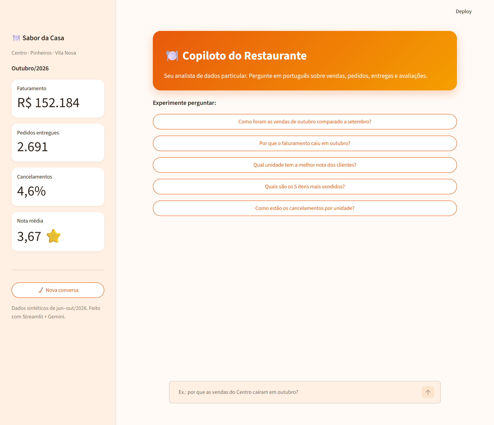
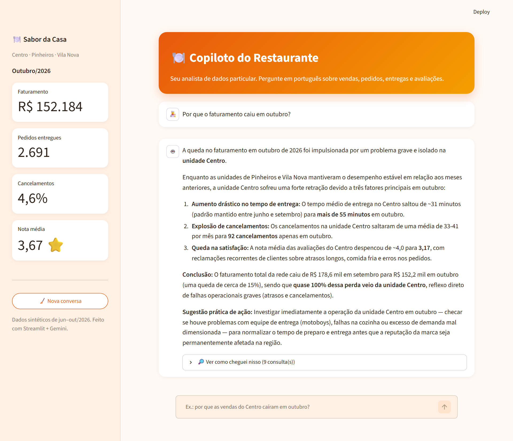

# 🍽️ Copiloto do Restaurante Parceiro

> Projeto em construção.

Agente de IA que ajuda o dono de um restaurante de delivery a entender suas vendas e avaliações em linguagem natural. Ele recebe a pergunta em português, escreve as consultas SQL, lê os resultados e responde de forma direta, mostrando também como chegou nos números.

Todos os dados são **sintéticos** (jun–out/2026, 3 unidades), gerados por `dados/gerar_dados.py`. O projeto não usa dados reais nem marcas de terceiros.





## O que já funciona

- 💬 **Chat com agente de análise**: perguntas abertas como "por que o faturamento caiu em outubro?" fazem o agente investigar períodos, unidades, cancelamentos e avaliações antes de concluir.
- 🔒 **SQL somente leitura**: o agente só executa `SELECT`, com o banco aberto em modo read-only.
- 🔎 **Transparência**: cada resposta traz as consultas SQL usadas.
- 📈 **Indicadores na barra lateral** e sugestões de perguntas para começar.

## Como rodar

```bash
pip install -r requirements.txt
python dados/gerar_dados.py        # gera o banco (se ainda não existir)

cp .env.example .env               # no Windows: copy .env.example .env
# edite o .env e cole sua chave gratuita do Google AI Studio:
# https://aistudio.google.com/apikey

streamlit run app.py
```

Para testar só o agente no terminal:

```bash
python agente/agente.py "Como foram as vendas de outubro?"
```

O modelo pode ser trocado com `MODELO_GEMINI` no `.env` (padrão: `gemini-3.5-flash-lite`).

## Deploy gratuito (Streamlit Community Cloud)

1. Acesse https://share.streamlit.io e entre com o GitHub.
2. *Create app* → escolha este repositório, branch `main`, arquivo `app.py`.
3. Em *Advanced settings → Secrets*, cole:
   ```toml
   GEMINI_API_KEY = "sua-chave"
   ```
4. *Deploy*. A chave fica só nos Secrets, nunca no código.

## Planejado

- 📊 Gráficos nas respostas e dashboard de indicadores
- 🧾 Triagem de avaliações: classificação, resumo e sugestão de resposta
- ⏰ Automação diária de relatório (n8n)
- ✅ Avaliação da qualidade do agente com casos de teste

## Tecnologias

Python · Streamlit · Gemini API · SQLite · pandas · Plotly · n8n
