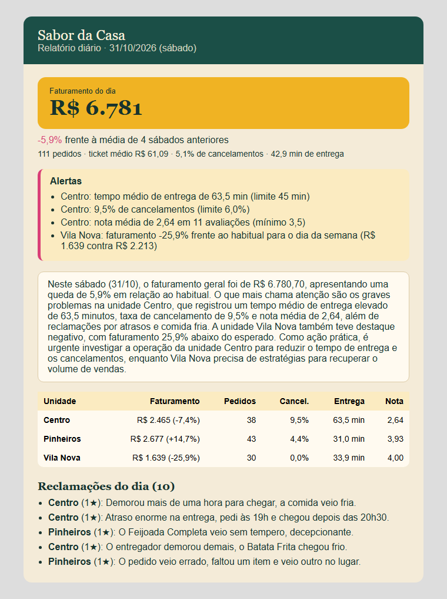

# Automação do relatório diário (n8n)

Todo dia às 08:00 o n8n busca o relatório do restaurante e envia por e-mail: faturamento do dia, comparação com os
mesmos dias da semana anteriores, alertas por unidade e reclamações. Opcionalmente inclui um resumo escrito pelo Gemini.



```
[n8n · agendador 08:00] → [HTTP: servidor.py] → [relatorio_diario.py] → [n8n · enviar e-mail]
```

## O que tem aqui

| Arquivo | Para quê |
|---|---|
| `relatorio_diario.py` | Gera o relatório (texto, HTML ou JSON). Só precisa de `pandas`. |
| `servidor.py` | Servidor local mínimo (biblioteca padrão) que o n8n chama por HTTP. |
| `n8n_relatorio_diario.json` | Fluxo pronto para importar no n8n. |
| `test_relatorio.py` | Testes (`python -m pytest automacao -q`). |

## 1. Testar o relatório sem n8n

```bash
python automacao/relatorio_diario.py                      # último dia com dados
python automacao/relatorio_diario.py --data 2026-10-31
python automacao/relatorio_diario.py --formato html --saida relatorio.html
python automacao/relatorio_diario.py --ia                 # com resumo do Gemini (usa GEMINI_API_KEY do .env)
```

Os dados de exemplo vão até 31/10/2026, então sem `--data` o relatório usa esse último dia. Com dados reais use
`--data ontem`.

Os limites que disparam alerta ficam no topo de `relatorio_diario.py` (`LIMITES`): tempo de entrega acima de 45 min,
cancelamentos acima de 6%, queda de faturamento acima de 20% frente ao habitual e nota abaixo de 3,5.

## 2. Subir o servidor

```bash
python automacao/servidor.py
```

- **n8n rodando direto na sua máquina** (por exemplo `npx n8n`): o padrão (`127.0.0.1`) basta e a URL do fluxo
  vira `http://localhost:8765/relatorio`.
- **n8n no Docker**: o servidor precisa aceitar conexões do contêiner e **deve ter um token**:

  ```bash
  # PowerShell                          # Linux/Mac
  $env:RELATORIO_TOKEN = "um-segredo"   # export RELATORIO_TOKEN=um-segredo
  python automacao/servidor.py --host 0.0.0.0
  ```

  A URL no fluxo continua `http://host.docker.internal:8765/relatorio`. No Linux, inicie o contêiner com
  `--add-host=host.docker.internal:host-gateway`.

Teste no navegador: `http://localhost:8765/relatorio?data=2026-10-31` (com token, use um cliente que envie o
cabeçalho `X-Token`).

## 3. n8n

1. Suba o n8n (gratuito): `docker run -it --rm -p 5678:5678 -v n8n_data:/home/node/.n8n docker.n8n.io/n8nio/n8n`
   ou `npx n8n`, e abra http://localhost:5678.
2. *Workflows → Import from file* e escolha `n8n_relatorio_diario.json`.
3. No nó **Buscar relatório**: confira a URL e troque `troque-este-token` pelo seu `RELATORIO_TOKEN`
   (se não usa token, apague o cabeçalho).
4. No nó **Enviar e-mail**: crie a credencial SMTP (no Gmail, use uma *senha de app*) e troque remetente e destinatário.
5. Clique em **Execute workflow** (pelo nó "Teste manual") e confira se o e-mail chegou.
6. Ative o fluxo com a chave no topo. O horário muda no nó "Todo dia às 08:00".

## O que foi testado

- Relatório, regras de alerta e servidor: testes automatizados (`python -m pytest automacao -q`), inclusive o token e
  os erros 400/404/401.
- Resumo por IA e HTML do e-mail: executados de verdade e conferidos.
- **O fluxo do n8n não foi executado dentro do n8n** (não dá para instalar o n8n no ambiente de desenvolvimento).
  O JSON segue o formato de importação, mas se algum nó pedir ajuste ao importar (versão do n8n, credencial),
  é só corrigir na tela.

## Ideias para evoluir

- Enviar também por Telegram/WhatsApp quando houver alerta (um nó "IF" sobre `{{ $json.alertas.length }}`).
- Relatório semanal com os mesmos dados agrupados por semana.
- Salvar cada relatório em uma planilha para histórico.
